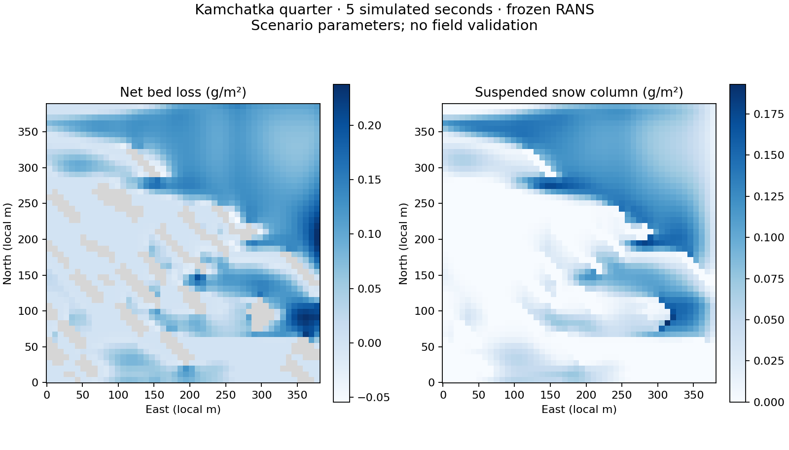

# Временная CFD снежная фаза: квартальный сценарий v1

23.11.2026 · Asia/Kamchatka · ФАКТ/РАСЧЁТ, исследовательский этап DRIFT-003.
Это реальный OpenFOAM v2512 runtime на 194581 воздушной ячейке геометрии квартала,
5 секунд сценария, неподвижная сетка и замороженные RANS U/nut/phi. Полевая точность
unknown. Этот этап не закрывает обратную связь сугроб → сетка → новый ветер.

## Постановка и контракт

Источник геометрии — `cfd/sources/quarter.json`, `ground.npz`; версия общей сцены
`drift-scene-1`, SHA b5237a92e4695c7de892cb96cb688beb36886db4fc20843bba0b920f5cdc36f1.
Восстановлен исходный coarse RANS на 84×85×28 с удалёнными вокселями зданий,
360 итераций; checkMesh OK. Для снежной фазы сохранён pressure-corrected face flux
phi, а не только интерполированные скорости. Хеши сетки, U/nut/phi, source и solver
есть в каждом summary.json. Повторное использование ветра проверяет provenance.

Собственный `cfd/snowSolver/kamchatkaSnowFoam.C` (GPL-3.0-or-later, сборка v2512)
решает концентрацию C в kg/m³:

```
dC/dt + div((U + settling)*C) - div((nut/Sc)*grad(C)) = exchange_source
```

Euler по времени, upwind конвекция, implicit uncorrected diffusion; относительный
допуск линейного решателя 0, абсолютный 1e-14. Воздух, турбулентность и сетка статичны.
Стены и симметрия непроницаемы; осаждение на грунт учитывается только обменом, без
повторного выноса через стенку. Снег крыш и перехват вертикальными фасадами не моделируются.
На открытых границах inletOutlet использует transportPhi, входная концентрация нулевая.
Диффузия — nut/0.7; молекулярная диффузия снежных частиц не добавляется.

Сценарное замыкание: ws=0.5 m/s, threshold friction speed=0.25 m/s;
E = coefficient × max((nu+nut_wall)|dU/dn| − threshold², 0) × projectedArea.
Коэффициент обычного опыта 0.001 kg·s/m⁴; это явно выбранный сценарий, не калибровка
по снегу Камчатки. D = ws × C_old × projectedArea. Запросы суммируются по владельцу
воздушной ячейки. E ограничен старой массой ложа, D — старой воздушной массой.
Обмен заносится в один source, а не в два независимых потока. Полученная масса
может повторно участвовать в обмене на следующем шаге.

Начальный запас передаётся из сцены в kg на столбец: 646529.377514 kg. Его нельзя
пересчитывать по округлённым граням сетки: первая попытка выявила сдвиг 0.006293 kg.
Фактические площади граней используются для E/D, фактические объёмы — для C×V.
Геометрия снега 0.025 m не прибавляется к mesh: feedback здесь отсутствует.

Полный бюджет берётся из `eqn.flux()` — того же численного advective+diffusive
потока, которым обновлялось поле, с отдельным накоплением входа и выхода.
Остаток = bed_final + air_final + boundary_out + loss − bed_initial − air_initial − boundary_in.
Допуск 1e-8 kg + 1e-12 × (bed_initial+air_initial+boundary_in).
Отрицательные C/запас, нечисловые итоги или превышение допуска останавливают runtime.
Python независимо повторяет audit каждого шага и интегрирует записанные C×V/bedMass.

## Выполненные опыты

| Опыт (все по 5 s) | dt, s | Воздух в конце, kg | Внешний выход, kg | Макс. модуль остатка, kg |
|---|---:|---:|---:|---:|
| Обычный сценарий | 0.1 | 6.962832 | 8.34e-13 | 1.44e-8 |
| Половинный шаг | 0.05 | 6.940926 | 1.51e-13 | 1.47e-8 |
| Нулевая эрозия, воздух изначально пуст | 0.1 | 0 | 0 | 0 |
| Стресс: коэффициент эрозии 100000 | 0.1 | 377473.909338 | 7.71e-7 | 3.08e-8 |
| Начальный воздушный импульс у западной границы | 0.1 | 59.450284 | 1437.085014 | 1.20e-9 |

В обычном опыте eroded=11.571523 kg, deposited=4.608691 kg,
bed_final=646522.414682 kg. Отрицательных масс нет на всех 300 временных шагах.
В импульсном контроле initial_air=1513.602423 kg; plume 0.001 kg/m³ задан в двух
западных столбцах, коэффициент эрозии нулевой. Это контроль граничного потока,
не погодное наблюдение. При исключении boundary_out offline тест закономерно падает.
В стресс-тесте суммарная эрозия 805266.766 kg превышает начальный запас за счёт
повторного переноса ранее осевшего снега; это внутренний оборот, не внешний источник.

Относительная L1 разность воздушных масс на одинаковых ячейках при dt/2 — 0.355654%.
Это одна проверка чувствительности по времени, не доказанная сходимость и не оценка
ошибки относительно наблюдений. Пространственная сходимость и длинный горизонт не проверены.

Компактные первичные журналы, таблицы шагов, summary и хеши:
[cfd/snow-evidence-v1](cfd/snow-evidence-v1/matrix-summary.json).
Полные поля и сетка оставлены локально в `/private/tmp/kamchatka-snow-runtime`;
они могут исчезнуть с временным каталогом. Бинарник не публикуется. Проверки saved
evidence не заменяют запуск решателя на чистой машине. PNG осмотрен визуально.



## Воспроизведение

Требуется ранее установленный локальный `kamcha-danil-openfoam:087118f` с
`/venv/bin/python`, snowmap.foam и OpenFOAM v2512. Image ID: `sha256:9f32050bbd3000b38e815e5baffffead44951e8e0979723fec9ea22b43d1b429`.
Его публичная/чистая сборка пока
не подтверждена. Каталог cfd смонтировать как /audit, city-sim как /model readonly,
пустой scratch как /runtime; PYTHONPATH=/model:/app, --network none, --cpus 2, --memory 3g.

```
# В контейнере bash: /audit/snowSolver/build.sh
# Сборка сохраняет /runtime/kamchatkaSnowFoam.
/venv/bin/python /audit/run_snow_matrix.py --work /runtime/matrix --solver /runtime/kamchatkaSnowFoam
```

Первый case рассчитывает RANS; остальные переиспользуют именно его проверенный
wind-provenance.json. Существующие каталоги не перезаписываются. Нет фоновых retries,
погодных запросов или вызовов solver из HTTP. Offline проверка из city-sim:

```
python ../docs/drift-engine/cfd/verify_snow_runs.py ../docs/drift-engine/cfd/snow-evidence-v1
python -m unittest city_sim.tests.test_saved_cfd_snow -v
```

Первые попытки сохранены локально: исправлены setup bashrc, отсутствующий include,
путь Python образа, тип frozen nut, инициализация запаса и точность стресс-решения.
После последнего изменения численной части все пять опытов повторены; после
добавления проверки provenance матрица повторена с теми же полями. Допуск массы
не ослаблялся. Запуск в существовавший каталог остановился без перезаписи.

## Далее

1. Более длинный горизонт, несколько dt и пространственных сеток с одинаковыми
   областями/начальными массами; проверить ошибки замыкания, задержку обмена и Co.
2. Замкнуть изменение snow geometry → mesh → новый CFD ветер, проверить качество mesh.
3. Проверенный переносимый образ и отдельный тяжёлый runtime CI; независимые измерения.
