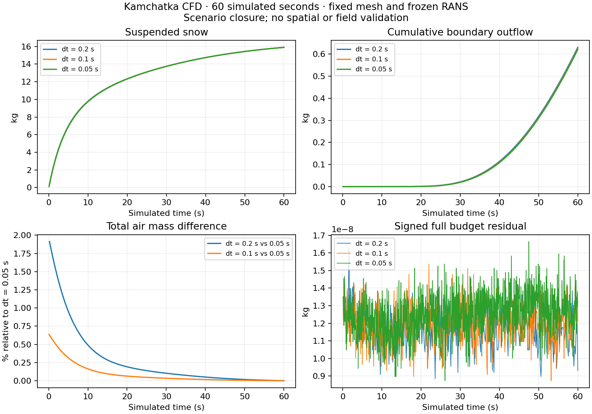

# CFD квартала: 60 секунд и сгущение временного шага

23.11.2026 · Asia/Kamchatka · ФАКТ/РАСЧЁТ. Продолжение DRIFT-003 поверх cc5e825.
Горизонт предыдущего [пятисекундного опыта](CFD_SNOW_CASE.md) увеличен в 12 раз.
Это временная проверка одного сценария на фиксированной сетке, не пространственная
сходимость и не полевая валидация. Сетка, ветер и сценарное замыкание не менялись.

## Выполненная конечная матрица

Три независимых запуска kamchatkaSnowFoam v2512 до 60 s с dt=0.2, 0.1, 0.05 s.
194581 ячейка, одна сцена b5237a92…, один pressure-corrected phi и U/nut, один
собранный бинарник. Начальный bed=646529.377514 kg, воздух пуст, осадков/внешнего
входа нет. E/D, settling=0.5 m/s и Sc=0.7 — те же сценарные параметры, что в первом
CFD отчёте. Никаких запросов погоды, новых данных или изменений HTTP/API.

Хеши всех общих входов сравнены перед интерпретацией результатов. Расчёты запущены
в установленном kamcha-danil-openfoam:087118f (--network none, --cpus 2, --memory 3g).
RANS не пересчитывался: переиспользован проверенный wind-provenance.json.
Предыдущие результаты не перезаписывались.

| dt, s | Шагов | Воздух в конце, kg | Выход за границы, kg | Максимальный модуль остатка, kg |
|---:|---:|---:|---:|---:|
| 0.20 | 300 | 15.8974963914 | 0.6305082012 | 1.630e-8 |
| 0.10 | 600 | 15.8973829996 | 0.6241236623 | 1.537e-8 |
| 0.05 | 1200 | 15.8973278425 | 0.6209313526 | 1.665e-8 |

Все 2100 шагов независимо прошли bed/air/boundary audit с прежним допуском
1e-8 kg + 1e-12×available. Отрицательных запасов/концентраций нет. Финальные
записанные C×V и bedMass отдельно интегрированы, а экспортированные массы всех
ячеек сохранены для повторной проверки без OpenFOAM.

Для dt=0.05 s: eroded=140.096650514 kg, deposited=123.578391318 kg,
bed_final=646512.859254937 kg. Разница bed_initial−bed_final ≈16.518259182 kg
равна воздушному запасу плюс граничному выходу до численного остатка. Это вычисленные
массы сценария; они не являются измерениями снега квартала.

## Различия при сгущении по времени

L1 считается по массам всех одинаково упорядоченных воздушных ячеек. Относительная
норма делится на суммарный воздушный запас более мелкого шага, а не на весь запас ложа.

| Пара шагов | Air L1, kg | Air relative L1 | Bed L1, kg |
|---|---:|---:|---:|
| 0.20 → 0.10 s | 0.004463127 | 0.0280746% | 0.080781958 |
| 0.10 → 0.05 s | 0.002264333 | 0.0142435% | 0.040393259 |

Наблюдаемый порядок air L1: log2(0.004463127/0.002264333)=0.978968.
Различия уменьшаются примерно вдвое, что согласуется с первым порядком по времени
для этой постановки. Это не ошибка относительно точного решения и не универсальная
гарантия сходимости. Уменьшение ошибки общей воздушной массы может скрывать
пространственное перераспределение: поэтому здесь сравниваются все ячейки.

Выход за границы отличается примерно на 0.51% между dt=0.1 и 0.05 s; временная
чувствительность потока заметнее, чем разница полного воздушного запаса. Минутный
горизонт позволяет проверить реальный выход обычного сценария, тогда как за 5 s
он был почти нулевым. Длительные метели и установившееся состояние этим не проверены.



## Evidence и воспроизведение

[cfd/time-evidence-v1/time-refinement.json](cfd/time-evidence-v1/time-refinement.json)
содержит точные результаты. Рядом полные CSV шагов, solver/postProcess logs,
summary, SHA256 и final-masses.npz каждого запуска. В npz хранятся kg воздушных
ячеек и kg ложа, не концентрации; порядок совпадает на всех трёх одинаковых mesh.
Полные mesh/C/V остаются локально в `/private/tmp/kamchatka-snow-runtime/time-study-v1`.
PNG проверен визуально. Бинарник в репозиторий не добавляется.

Запуск в том же CFD-образе с /audit=cfd, /model=city-sim readonly, /runtime=scratch,
PYTHONPATH=/model:/app:

```
# Подготовить бинарник: bash /audit/snowSolver/build.sh
/venv/bin/python /audit/run_time_refinement.py --work /runtime/time-study --solver /runtime/kamchatkaSnowFoam
```

Первый case при отсутствии --reuse-wind выполняет RANS; второй/третий переиспользуют
его проверенные данные. Для уже имеющегося RANS разрешён --reuse-wind с соответствующим
wind-provenance.json. Свежий work обязателен: существующие case не перезаписываются.
Матрица конечная, без автоматических повторов.

Offline проверка из city-sim:

```
python ../docs/drift-engine/cfd/verify_time_refinement.py ../docs/drift-engine/cfd/time-evidence-v1
python -m unittest city_sim.tests.test_cfd_time_refinement -v
```

Verifier проверяет SHA, формы и неотрицательность массивов, суммы экспортированных
полей, каждый шаг ledger, согласованность входов и повторно вычисляет нормы/порядок.
Три новых теста добавлены к обычной suite. Чистый переносимый образ и тяжёлый CFD CI
остаются отдельной незавершённой задачей; обычный CI читает сохранённые evidence.

## Следующий этап

Пространственное сгущение требует согласованных областей и консервативного переноса
начального запаса: нельзя просто назначить прежние kg на каждую новую ячейку.
Сначала подготовить несколько сеток и проверку одинакового интегрального bed;
для сравнения разных сеток нужен общий физический контрольный объём. Затем выполнить
CFD с согласованными входами и отдельно оценить изменение RANS и снежной фазы.
После этого — snow geometry → mesh → новый воздух. Пока geometry/air feedback нет,
геометрия крыш/перехват фасадами и измеренный DTM не добавлены, точность unknown.

Проверки этапа: 103 city_sim tests OK (без skips), 5 core OK. В новом checkout
первая полная suite выявила отсутствующую локальную привязку к pinned модели Данила;
после указания CITY_SIM_DANIL на сохранённые проверяемые исходники suite прошла.
Код модели не менялся. Новый CFD runtime и offline verifier также прошли.
