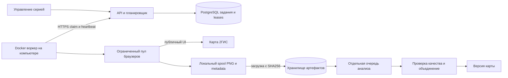

# План сервиса детальной съёмки дорожного трафика

23.11.2026 · Asia/Kamchatka. Статус: ПЛАН, без запуска инфраструктуры.
Назначение: Eazyan/KamDispatch, отдельное продолжение GRAPH-002.

Компьютер пользователя становится вычислительным узлом: получает задания,
запускает изолированные браузеры в Docker, сохраняет снимки и возвращает проверенные
результаты. Сервер управляет очередью, версиями карты и публикацией. Начинаем с
конечных запусков; периодичность включается только после проверки качества,
производительности и условий источника.

## Что уже есть и чего пока нет

ФАКТ: в ветке codex/graph-2gis-pilot, код 6f9fd17, есть последовательный capture,
привязка по четырём UI-точкам, парные PNG off/on, хеши, интервалы на graph_v3,
исходный raster слой и карта проверки. 31 снимок zoom16 покрывает географию
11689 физических коридоров. Это не полное измерение трафика: большинство длины
графа остаётся unknown. 35 offline tests и CI прошли; независимая точность на
размеченном holdout не установлена.

Существующий capture запускает локальный браузер через CDP. Удалённой очереди,
Linux browser-worker, Docker-сервиса и согласованной параллельной серии пока нет.
Исходные файлы в этом checkout: scripts/capture_traffic.py,
scripts/capture_traffic_city.py, scripts/graph_traffic.py,
scripts/traffic_city.py, monitoring/traffic_graph.py, monitoring/traffic_raster.py.

Больше кадров увеличивает потенциальную детализацию. Высокая точность требует
отдельно доказать правильную привязку, полноту выделения, класс цвета и назначение
конкретной дороге. Наличие пикселей в снимке не означает наличие наблюдения на ребре.

## Предлагаемая схема

Предпочтительно воркер сам забирает задания с сервера через исходящий HTTPS.
Открытый IP компьютера не обязателен; это работает и при изменении адреса/NAT.
Сервер логически командует компьютером через очередь. Если нужен именно входящий
запрос, оставить один HTTPS API за VPN или с mTLS, а не порт Docker/CDP.

При отсутствии отдельного сервера сначала разместить API, БД, worker и хранилище
на одном компьютере через Compose. Контракты те же, позже компоненты можно разнести.

## Состав Docker развёртывания

| Компонент | Место | Назначение |
|---|---|---|
| control-api и scheduler | сервер или тот же компьютер | создание серии, выдача заданий, отмена, состояние |
| PostgreSQL | рядом с API | durable очередь, leases, транзакции, аудит |
| capture-worker | компьютер пользователя | фиксированный браузерный пул и локальный spool |
| analysis-worker | компьютер или сервер | обработка сохранённых PNG без запросов провайдеру |
| object storage | сервер или локальный volume в первом MVP | PNG, metadata, masks, версии результатов |
| map service | сервер | только чтение готовых версий, partial и stale явно |

Для одного узла достаточно очереди в PostgreSQL с lease и SKIP LOCKED; отдельный
Redis/RabbitMQ не нужен до появления измеренной причины. Local spool — буфер
при разрыве сети, а не вторая конкурирующая очередь. API получает единоличное
право выдавать lease. Диск и БД сохраняются в volumes, контейнеры заменяемы.

Browser image: Linux Chromium + Playwright совместимых закреплённых версий,
не зависимость от установленного на Mac Yandex. Non-root пользователь, рабочий
Chromium sandbox, init и явно выделенная shared memory. Контейнер получает
только свой spool и credentials сервиса. Не получает docker.sock и личный профиль
браузера; CDP остаётся внутри контейнера. ОС и архитектура удалённого ПК пока неизвестны.

## Задания и восстановление

Предлагаемый API: POST /runs, GET /runs/{id}, POST /runs/{id}/cancel,
POST /workers/claim, POST /jobs/{id}/heartbeat и POST /jobs/{id}/complete.
Все задания типизированы; API не принимает произвольную shell-команду или URL.

Контракт задания: run_id, tile_id, attempt, graph_sha256, plan_sha256,
provider, allowed_source_url, zoom, viewport, DPR, bbox/analysis_region,
capture_config_sha256, deadline_at, lease_token и lease_expires_at.

Контракт результата: worker_id, image/browser/code versions, four calibration
controls и holdout_error_px, camera parameters до/после, off/on timestamps,
provider_updated_at (null если неизвестно), source hashes, upload manifest,
quality flags и rejection_reason. Времена UTC плюс серверное время приёма;
длительности измеряются монотонными часами, часы хостов синхронизируются.

Состояния: queued → leased → capturing → uploaded → analyzing → accepted/rejected;
отдельно retry_wait, cancelled и blocked_provider. Lease TTL рассчитывается по
p99 времени задания, heartbeat продлевает его. Истечение lease возвращает задание
в очередь; результат старого lease не может перезаписать результат нового.

Доставка at-least-once, применение результата идемпотентное. Уникальный ключ
run/tile/config, отдельный attempt и контроль SHA артефактов. Сначала загрузка во
временное имя, затем проверка manifest и атомарный complete в БД. Частичная пара,
битый PNG и чужой graph SHA никогда не становятся accepted. Один tile внутри
серии принимается один раз; другие attempts сохраняются в аудите.

Отмена прекращает выдачу новых заданий, останавливает активные браузерные задачи
и дочерний анализ, сохраняет уже готовые пары. Выключение ПК, рестарт контейнера,
потеря сети и повтор complete проверяются fault-тестами. Никаких вечных retries:
до трёх попыток transient ошибки с backoff/jitter; ошибки схемы и привязки — в review.
403/429/CAPTCHA останавливают съёмку источника на уровне всей серии. Без ротации
IP/профилей для обхода ограничений; offline анализ при этом может продолжаться.

## Планирование кадров для покрытия и точности

1. Зафиксировать graph SHA и физические коридоры, исключив направленные дубликаты.
2. Сравнить zoom16 и zoom17 на одних улицах и одинаковом viewport. Измерить метры
на CSS-пиксель, видимую долю лент, назначения и затраты. Выбрать масштаб по данным.
3. Построить сетку с перекрытием из измеренной калибровки, а не догадки о zoom.
Для разработки предложено 15–25% перекрытия; окончательное значение выбрать по
ошибке швов и полезному покрытию. Пустые клетки исключать геометрическим пересечением.
4. Детализировать сложные места: параллельные проезды, развязки, дворы, тонкие
ленты, высокая доля ambiguous. Повторный крупный кадр должен закрывать конкретный
rejection, а не бесконечно переснимать весь город.
5. Проверить union фактических footprints по полным полилиниям. Исключить панели,
рекламу, controls, края маски. Нужен отчёт uncovered geometry, не только число кадров.
6. На каждый tile ограничить число refinements и общий бюджет серии в кадрах,
байтах, времени и запросах. Даже адаптивная серия имеет конечный manifest.

Ориентир РАСЧЁТ: при том же viewport переход zoom16 → zoom17 увеличивает плотность
кадров примерно в четыре раза; 31 кадр может превратиться примерно в 124 до учёта
формы границы и перекрытий. Это оценка планирования, не готовая сетка или SLA.
Меньший viewport потребует ещё больше кадров. Географически меньший кадр важнее
уменьшения PNG в пикселях; варианты 1920/2560/4096 надо сравнить на том же AOI.

## Достоверность парной съёмки

Один browser slot выполняет off и on последовательно в одной камере. Нельзя
параллелить эти два кадра по разным браузерам: изменятся карта и геопривязка.
Между переключениями проверяются center/zoom/rotation/viewport/DPR. Референс
достаточно близок по времени к on; допустимый разрыв — настройка с отдельным тестом.

Готовность карты определяется состоянием UI, несколькими стабильными контрольными
снимками и отсутствием placeholder в полезной области, с timeout; один networkidle
или фиксированный sleep этого не доказывает. Анимированные объекты/мигание маскируются.
Проверки камер и привязки выполняются для каждого задания. На старте сохранить
четыре независимые UI-точки, а ускорение калибровки допускать только отдельным опытом.

Результат сохраняет два разных слоя: исходное наблюдение провайдера и назначение
на graph_v3. Сглаживание белых стрелок влияет только на отображение; raw mask
и raw PNG остаются. В unknown нельзя дорисовывать поток по соседним зелёным улицам.
Пока направление unresolved, класс цвета не превращается в скорость/travel time.

## Параллелизм и бюджет серии

Разделить browser_slots, analysis_processes и upload_concurrency. Пул браузеров
не равен пулу всех CPU: Chromium может упереться в RAM, GPU, shared memory, сеть
и скорость UI. На первом стенде один slot; затем 2, 4 и, только если есть выигрыш,
8. Это ступени эксперимента, не обещание допустимой нагрузки на 2ГИС.

У всех браузеров одного источника общий лимит частоты и circuit breaker. Добавление
слотов не должно умножать разрешённую интенсивность. Иначе получим больше ошибок,
а не более точную карту. Offline анализ и загрузку PNG можно масштабировать
независимо, без новой нагрузки на провайдера. Browser slots переиспользуют процессы
с изолированными контекстами; при падении/росте памяти slot заменяется.

Измерять p50/p95 длительности capture, ошибки, качество, RAM/CPU/shm, размер PNG,
скорость upload и возраст очереди. Выбирать максимальную конкуренцию, при которой
не ухудшаются полнота кадра, привязка и доля отказов. Глобальный лимит источника
имеет приоритет над свободными CPU.

Расчёт времени: T ≥ max(N × t_capture / C_effective, B / upload_rate,
analysis_work / analysis_capacity) плюс очередь, retries и сборка. Если ПОСЛЕ замеров
N=124, t_capture=45 s и C_effective=4, идеализированная нижняя оценка capture —
23.25 минуты; при 8 — 11.625 минуты. Сетевой лимит может сделать их недостижимыми.
Это условный пример, не измерение нашего Linux-воркера.

RAM оценивать по peak одного slot плюс reserve, а не по числу вкладок. Один
4096×4096 RGBA buffer — 64 МиБ; браузер держит несколько поверхностей, а PNG
распаковывается отдельно. Диск: runs × tiles × (off + on + masks + artifacts),
плюс временные загрузки и резерв. Фактические коэффициенты получить из pilot manifest.

## Временная согласованность всей карты

Серия из сотни кадров не является одним моментом времени. Задать целевое окно
W и допустимую давность до запуска. Группировать соседние клетки в один временной
пакет, фиксировать для каждого интервала age и timestamp. Параллельная съёмка
сокращает разброс, но не устраняет его.

В перекрытиях учитывать качество, разрешение и время. Не давать старому кадру
перезаписать свежий, а лучшему zoom — скрыть факт устаревания. Для пересекающихся
данных разных времён хранить обе версии; несовместимые классы внутри допустимого
окна помечать conflict. Выбор отображаемого наблюдения детерминированный и объяснимый.
Если W не выдержано, выдавать явно историческую/частичную мозаику; не подписывать
«текущие пробки». Новую версию карты публиковать атомарно; предыдущая доступна для отката.

## Проверка очень высокой точности

Заморозить эталон ДО подбора параметров. Минимальный отдельный пилот: не менее
12 участков, по четыре в development/validation/holdout, разные районы и геометрия;
это план размера выборки, не гарантия статистической мощности. Соседние кадры и
повторы одной улицы не делить случайно между train/holdout. После первичного пилота
рассчитать нужный объём по числу ошибок и ширине доверительных интервалов.

Размечать исходные ленты, отсутствие наблюдения, класс, границы интервала и верную
физическую дорогу. Отдельно перепроверить спорные случаи вторым разметчиком. Не
использовать наш matcher как источник собственной «правильной» разметки.

| Измерение | Что считать |
|---|---|
| Географический охват | доля полной длины графа внутри принятых footprints |
| Выделение | precision/recall длины относительно вручную видимых лент |
| Назначение | доля длины на правильной дороге, false assignment соседним дорогам |
| Цвет | confusion matrix и precision по каждому классу, включая unknown |
| Границы | ошибка начала/конца интервала в метрах |
| Непрерывность | искусственные разрывы на км видимой непрерывной ленты и длина разрывов |
| Свежесть | длительность серии, p95/max age, доля устаревшей длины |
| Отказы | причины и доля rejected/ambiguous, без исключения сложных случаев из отчёта |

Сравнить 31-кадровый baseline и новые настройки на ОДНИХ замороженных парах;
zoom сравнить на максимально близких по времени кадрах, учитывая изменчивость трафика.
Критерий запуска: заранее согласованный предел ложных назначений и границ,
нижняя доверительная граница precision, полнота видимых лент и временное окно.
Числа согласовать после pilot; не объявлять произвольные 99% достигнутыми.
Высокое precision ценнее принудительной окраски всех дорог: reject остаётся допустимым.

## Последовательность реализации

| Этап | Конкретный результат | Проверка перед следующим этапом |
|---|---|---|
| 0 Источник и стенд | паспорт ПК, доступ к данным, окно W, бюджет, AOI | проверены условия регулярного сбора/хранения/распространения, выбран capture или официальный источник |
| 1 Linux capture | Dockerfile, один browser slot, shared memory, pinned versions | три разные реальные пары в Linux, калибровка, cache, cancel, без пользовательского профиля |
| 2 Воспроизведение и эталон | frozen fixtures, разметка, evaluator, regression report | сравнение существующего matcher без новых сетевых запросов |
| 3 Durable управление | API, PostgreSQL lease, artifact manifests, auth | kill/restart/network-loss/duplicate-complete/expired-lease тесты |
| 4 Детальная сетка | zoom/viewport benchmark, adaptive budget, preview plan | непрерывный охват геометрии, нет бесконечного refinement |
| 5 Нагрузка | замеры 1→2→4 slots, analysis/upload отдельно | throughput растёт без деградации качества и лимитов источника |
| 6 Полная серия | один конечный городской run и версия карты | coverage, holdout, temporal report, reload и rollback |
| 7 Эксплуатация | наблюдаемость, retention, инструкции, расписание при заказе | ручная отмена, восстановление ПК, актуальность и лимиты диска проверены |

Первый реальный кодовый шаг — отдельный Linux Docker capture с одним slot и
тремя контрольными парами; затем очередь. Оборачивание текущего Mac CDP-скрипта
в публичный endpoint не является готовым сервисом.

Планируемые артефакты: compose.traffic-worker.yml, containers/traffic-worker/Dockerfile,
traffic_service/{api,queue,worker,planner,artifacts,evaluator}, DB migrations,
schemas/job/result, tests/faults, docs/road-graph/TRAFFIC_WORKER_RUNBOOK.md.
Имена — проект, этих компонентов сейчас нет. Изменения сервиса вести отдельной
веткой от согласованной базы KamDispatch; текущий PR #8 не сливать автоматически.

## Доступ к компьютеру и эксплуатация

При открытом IP публиковать только аутентифицированный HTTPS API за reverse proxy
или использовать VPN. Админ-доступ через SSH/VPN, отдельный ключ воркера, его отзыв
и ограничение ролей. API не даёт управлять произвольными контейнерами и чужими
файлами. Docker daemon, БД, очередь и CDP не открываются в интернет.
Ограничить CPU/RAM/PIDs, задать stop grace period, ротацию логов и disk watermark;
по исчерпанию диска — остановка выдачи, а не тихое удаление ещё не загруженных PNG.

Dashboard: planned/captured/accepted/rejected, активные leases, throughput,
возраст последнего кадра и очереди, blocked_provider, свободный диск, worker offline.
Логи и метрики не содержат credentials. Retention сырья, экспорт и доступ к
скриншотам задаются отдельно; до их удаления должен сохраниться необходимый
воспроизводимый validation набор с разрешённым доступом.

Для регулярного сервиса сначала проверить доступный официальный вариант 2ГИС:
в документации существует Traffic API Proxy, но это не доказательство доступного
нам бесплатного доступа. Согласовать покрытие, лицензию, квоты, хранение и стоимость.
Архитектура provider adapter позволяет перейти на лицензированные данные без
переписывания очереди. Никаких платных подписок или запросов этот план не создаёт.

## Что нужно уточнить перед развёртыванием

ОС и CPU архитектура ПК, ядра/потоки, RAM, свободный SSD; Docker/WSL2/Linux;
скорость upload; где живёт управляющий сервер; доступен ли исходящий HTTPS;
нужна ли именно входящая связь; требуемое окно свежести и частота запуска;
права на регулярный сбор и распространение. Пароли и ключи в документ не вносить.
До этих сведений нельзя честно назначить число браузеров, порт и SLA.

## Документация для реализации

Проверено 23.11.2026. Эти источники описывают платформы, а не подтверждают наши
будущие показатели точности или производительности.

- [Playwright Docker](https://playwright.dev/docs/docker): браузеры/системные зависимости,
совместимость версий, non-root sandbox, init и shared memory.
- [Защита Docker daemon](https://docs.docker.com/engine/security/protect-access/):
защищённый удалённый административный доступ через SSH/TLS.
- [2ГИС Maps API architecture](https://docs.2gis.com/en/on-premise-api-platform/architecture/maps):
Traffic API Proxy и лицензируемые компоненты картографической платформы.
