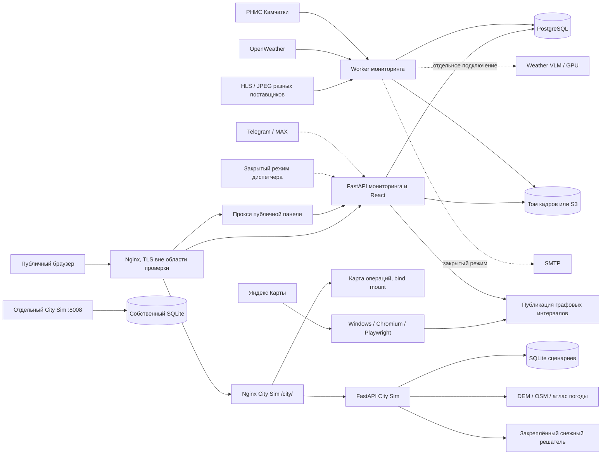

# Архитектура Камчатки

Аудитированный GitHub `main` — `9a1519da72f3570af9100243422d7578d3a236ae`. Публичный стек на 8080 работает из двух Windows checkout. Основной образ собран из `1c3cdd8`, карта взята из дерева `adc5e525…` на `2bf45fc`, прокси и шлюз запускаются как конфигурация развёртывания. На публичном 8008 работает отдельный City Sim из репозитория NDaVS на `7d567eb` с локальным патчем снежного адаптера. Контрольные суммы и различия описаны в [evidence/runtime-fingerprints.md](evidence/runtime-fingerprints.md).

| Подсистема | Фактическая реализация и входы | Что получает пользователь |
| --- | --- | --- |
| Карта высот, здания, дороги | Локальные DEM Copernicus, OSM и подготовленные GeoJSON/тайлы. MapLibre/Three в City Sim, Leaflet на основной карте. Для адресов используется общий поисковый модуль и локальные OSM-выгрузки. | Локальная геометрия и контекст. Снимок данных стареет независимо от свежести камер. |
| Снежные наносы | Отдельный City API на SQLite с историческими сценариями и запиненным внешним решателем. В основную панель снежный статус передаётся через адаптер, а полноразмерная интерактивная карта работает в City Sim. Параллельный CFD — исследовательский контур. | Прогноз для проверки участка. Штатная готовность решателя не измеряет точность вычисления на местности. |
| Камеры | Настроенный каталог, HLS/JPEG → FFmpeg или декодер Pillow → медиа/кадр в PostgreSQL → опциональный Weather VLM → правила подтверждения. | Кадр, время, статус и в закрытом режиме оперативный сигнал. |
| Пробки | Chromium/Playwright читает слой Яндекс Карт. Воркер сопоставляет цвета дорожному графу, публикует интервалы. FastAPI проверяет хеш графа, добавляет помеченные расчётные интервалы и TTL. | Цвет на карте, статус недоступности и приглушение просрочки в клиентском коде. |
| Автобусы | РНИС → проверка времени и типа GPS → запись точек и проездов → кандидаты к проверке. Демометки генерируются отдельно. | Маршруты, измеренное время и признаки задержки. Локальный эксперимент отключает реальные РНИС-запросы. |
| Обращения | Сайт, API, Telegram и MAX используют PostgreSQL, локальный справочник и геокодирование как дополнительный источник. | В закрытом режиме обращения попадают в очередь. Публичный шлюз на 8080 не публикует сайт обращений. |
| Задания | API диспетчера и адаптеры для бригад, привязка к участку, история, назначение, подтверждение и статусы хода работы. | Закрытый контур. Публичный прокси очищает очередь и списки, публичный шлюз не отдаёт API диспетчера. |
| Остальные части | `snegoplan` хранит подготовку графа, HGS и маршрутизатор, `city-sim/shared/universal_search` — SQLite/FTS-индексацию, `cameras` — сервис модели, `knowledge` и `docs` — зафиксированные материалы и контракты. | Планирование и исследовательские расчёты имеют отдельные точки запуска. Публичный шлюз не связывает их с автоматическим назначением работ. |

## Каскады и точки отказа

- Один Windows-хост несёт публичный шлюз, панель, PostgreSQL, City Sim и воркер пробок. Потеря хоста убирает обе публичные выдачи и доступ к локальным томам. Другое рабочее место может восстановить вычисления из кода и согласованного бэкапа.
- PostgreSQL → API → публичный прокси → панель. Отказ базы даёт три разных сигнала: веб 200, readiness 503, данные панели 500. City Sim на SQLite остаётся доступным. Это воспроизведено в F06.
- Worker → получение погоды, камер и ETA → БД → интерфейс. Остановка worker оставляет API и readiness зелёными. Публичная панель скрывает heartbeat. Это воспроизведено в F07.
- Яндекс / браузер / граф → публикация → кэш 20 с → карта. Смена схемы или хеша вызывает 503. Пропавший внешний источник без обновления может давать просроченный, но формально валидный ответ до отказа клиентских проверок свежести. F03 проверяет API и наличие TTL, код клиента проверен статически.
- City API → upstream Nginx → загрузка слоёв и симуляция. При остановке API статические файлы продолжают отдаваться. Readiness API перестаёт отвечать до клиентского таймаута F05.
- Сервис входа, модель, SMTP, Telegram и MAX включаются конфигурацией закрытого окружения. Их отсутствие нельзя диагностировать по публичному `/healthz`.

Источники кода: [compose.yaml](../compose.yaml), [compose.city-3d.yaml](../compose.city-3d.yaml), [monitoring/api.py](../monitoring/api.py), [monitoring/worker.py](../monitoring/worker.py), [monitoring/operations.py](../monitoring/operations.py), [monitoring/traffic_feed.py](../monitoring/traffic_feed.py), [traffic_service](../traffic_service), [city-sim/city_sim/api.py](../city-sim/city_sim/api.py), [public.nginx.conf](deploy/public.nginx.conf). Документированы CI универсального поиска и Drift с фильтрами путей. Штатные интеграционные тесты проверки стека запускались отдельно. [CI](../.github/workflows)
